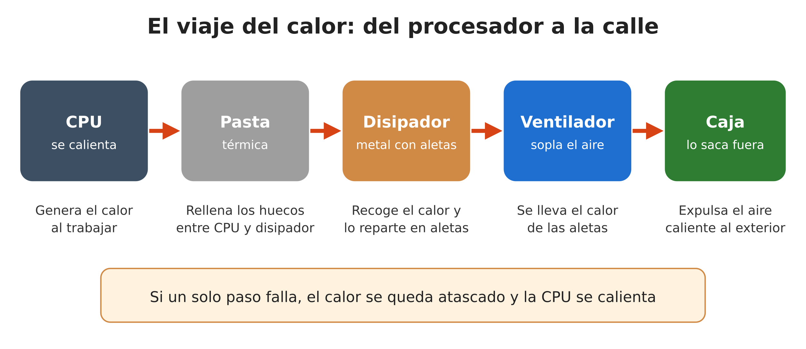
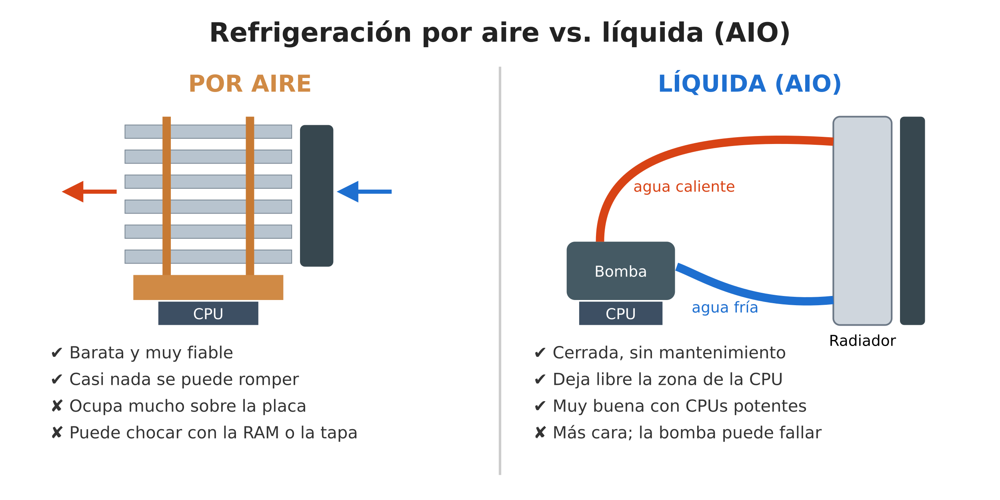
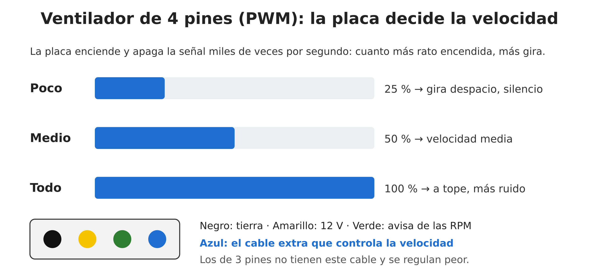
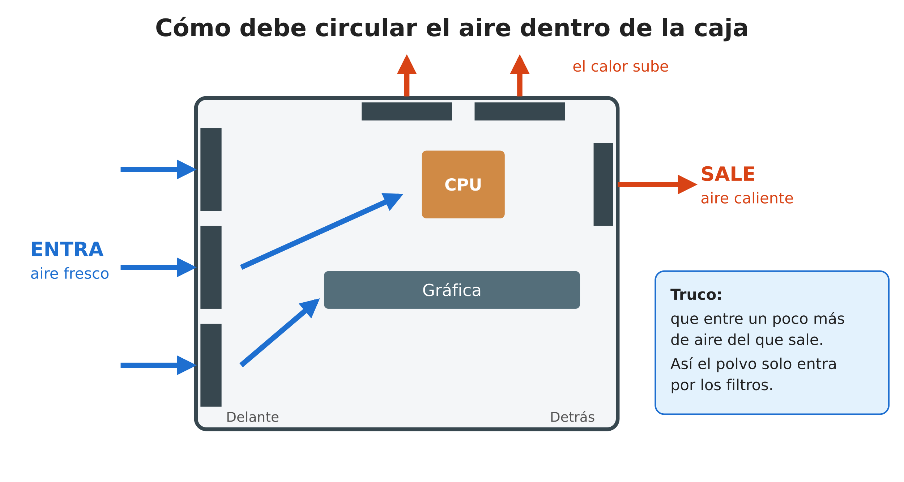
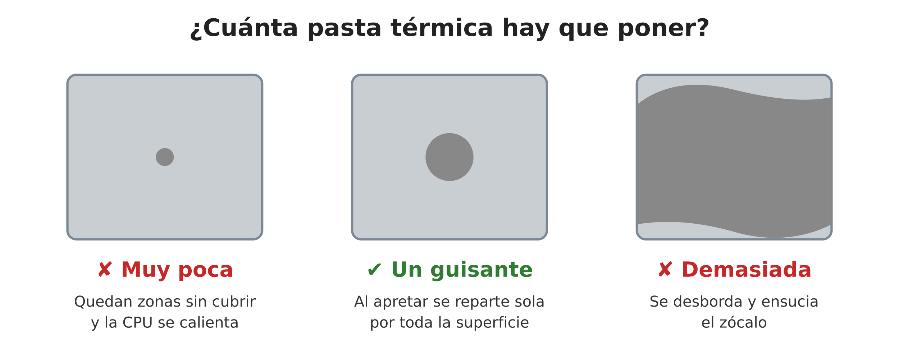

# Puzzle UT2 · Pieza 10: Caja y refrigeración

**Grupo:** Alejandro Correa (@aleexhlanz21) · Adrian Gamez (@adrian-codes-v2)

**Módulo:** Sistemas Informáticos - 1º DAW

---

## 1. Qué es y qué función cumple en el sistema

Cuando un ordenador trabaja, sus componentes **se calientan**. Es inevitable: casi toda la electricidad que gasta el procesador (CPU) o la tarjeta gráfica acaba convertida en calor. Un procesador potente puede calentar tanto como una pequeña estufa concentrada en un trozo de silicio del tamaño de una uña.

Si ese calor no se saca, pasan cosas malas:

- **El PC va más lento.** Cuando la CPU llega a unos 95–100 °C, se protege bajando su velocidad. A esto se le llama *thermal throttling*.
- **Se apaga solo** si la temperatura sigue subiendo.
- **Los componentes duran menos**, porque el calor los desgasta.

La **refrigeración** es el conjunto de piezas que se encargan de sacar ese calor: la pasta térmica, el disipador, los ventiladores y, si la hay, la refrigeración líquida. Y la **caja** no es solo “la carcasa bonita”: organiza por dónde entra y por dónde sale el aire, filtra el polvo y decide cuántos ventiladores caben.

## 2. Cómo funciona por dentro

La idea es muy sencilla: **el calor siempre pasa de lo caliente a lo frío**. La refrigeración solo tiene que montar un “camino” para que el calor salga del procesador y acabe fuera de la caja.

**Figura 1 (elaboración propia).** Es como una cadena de cinco pasos:

1. **CPU:** genera el calor al trabajar.
2. **Pasta térmica:** aunque la CPU y el disipador parecen lisos, tienen huecos microscópicos llenos de aire, y el aire es un pésimo conductor del calor. La pasta rellena esos huecos.
3. **Disipador:** un bloque de metal (cobre y aluminio) que recoge el calor. Suele tener **heatpipes**, unos tubos de cobre con un poco de líquido dentro que se evapora con el calor, sube hasta las aletas, se enfría y vuelve. Así mueven el calor muy rápido.
4. **Ventilador:** sopla aire entre las aletas y se lleva el calor.
5. **Caja:** sus ventiladores sacan ese aire caliente fuera del ordenador.

Si cualquiera de los pasos falla (pasta seca, aletas llenas de polvo, caja sin ventilación…), el calor se queda atascado y la CPU se calienta.

En la **refrigeración líquida AIO** (*All-In-One*, “todo en uno”) el paso del disipador se cambia por un circuito de agua: una **bomba** colocada sobre la CPU mueve el líquido por unos tubos hasta un **radiador**, donde los ventiladores lo enfrían, y el agua vuelve fría. Viene cerrada de fábrica, así que no hay que rellenar nada.

**Figura 2 (elaboración propia).** A la izquierda, un disipador de aire: el ventilador empuja aire frío entre las aletas y sale caliente por el otro lado. A la derecha, una AIO: el agua caliente va al radiador y vuelve fría a la bomba.

## 3. Características, unidades y cómo se miden

Cuando miramos la ficha técnica de un disipador o de un ventilador, estos son los datos que aparecen:

| Dato | Unidad | Qué significa en cristiano |
|---|---|---|
| **TDP** | vatios (W) | Cuánto calor tiene que ser capaz de sacar el disipador. A más W, más potente debe ser. |
| **Temperatura** | grados (°C) | Lo caliente que está la CPU. Se mira en la BIOS o con programas como HWMonitor. |
| **Velocidad** | RPM | Vueltas por minuto del ventilador. Más RPM = más aire, pero más ruido. |
| **Caudal** | CFM o m³/h | Cuánto aire mueve el ventilador. |
| **Presión estática** | mmH₂O | La “fuerza” con la que empuja el aire cuando algo le estorba (un radiador, un filtro). |
| **Ruido** | dB(A) | Lo que se oye. Por debajo de 25 dB(A) es muy silencioso. |
| **Vida útil** | horas (MTTF) | Cuánto aguanta el ventilador antes de fallar, de media. |

**Ojo con el TDP.** Es la cifra que más se usa, pero engaña un poco: los procesadores modernos pueden gastar bastante más en momentos de máxima carga. Por ejemplo, Intel indica que el Core i9-14900K tiene **125 W de potencia base**, pero puede subir a **253 W en turbo** ([Intel](https://www.intel.com/content/www/us/en/products/sku/236773/intel-core-i9-processor-14900k-36m-cache-up-to-6-00-ghz/specifications.html)). En AMD pasa algo parecido: un Ryzen con 170 W de TDP puede consumir hasta 230 W ([TechPowerUp](https://www.techpowerup.com/295301/amd-clarifies-ryzen-7000-zen-4-tdp-and-power-limits-170w-tdp-230w-ppt)). **Consejo:** elige siempre el disipador pensando en la cifra alta.

**Caudal o presión: no todos los ventiladores sirven para lo mismo.**

- Los de **caudal** mueven mucho aire cuando no hay nada delante. Son ideales para la parte delantera y trasera de la caja.
- Los de **presión estática** empujan con más fuerza y son mejores para radiadores y disipadores con muchas aletas, donde el aire “se atasca”.

**¿Cómo se controla la velocidad? El PWM.** Los ventiladores de **4 pines** tienen un cable extra con el que la placa base les dice a qué velocidad girar. La placa enciende y apaga esa señal unas 25.000 veces por segundo: cuanto más tiempo está encendida, más rápido gira el ventilador ([especificación de Intel](https://www.konilabs.net/docs/standards/fan/intel_4wire_pwm_fans_specs_rev1_2.pdf)). Así el PC está en silencio cuando no hacemos nada y solo sube de vueltas cuando hace falta. Además, si se pierde esa señal, el ventilador gira al máximo por seguridad ([Noctua](https://manuals.plus/m/dc1f7af634746c1a1846af4929f2c158135001fe0deb1696130ceafa51fbdba4.pdf)).

**Figura 3 (elaboración propia).** La barra azul representa el tiempo que la señal está encendida. Con un 25 % el ventilador gira despacio y apenas se oye; con un 100 % va a tope. Abajo, los colores de los cuatro cables. Los ventiladores de **3 pines** no tienen el cable azul y solo se pueden regular bajándoles el voltaje, que es menos preciso.

## 4. Tipos, evolución y estándares actuales

**Tipos de refrigeración**

| Tipo | Lo bueno | Lo malo | ¿Para quién? |
|---|---|---|---|
| **Pasiva** (sin ventilador) | Silencio total | Solo vale para chips que se calientan poco | Mini PC, routers |
| **Por aire** | Barata, fiable, casi nada se rompe | Ocupa mucho; puede chocar con la RAM | La mayoría de PCs |
| **Líquida AIO** | Deja libre la zona de la CPU, enfría muy bien | Más cara; la bomba puede fallar | Gaming y CPUs potentes |
| **Líquida custom** (montada por piezas) | La que mejor enfría | Cara, difícil y necesita mantenimiento | Entusiastas |

**Tipos de pasta térmica:** la más normal es la de **silicona o cerámica**, que no conduce la electricidad y es segura. También hay pastas con **partículas metálicas** (algo mejores) y el **metal líquido**, que es la que mejor enfría pero **conduce la electricidad**, así que si se derrama sobre la placa puede provocar un cortocircuito. Para clase o para un PC normal, la de silicona es la buena.

**Un poco de historia:**

- Los primeros PCs llevaban solo un trozo de metal encima del procesador, sin ventilador.
- Después llegaron los ventiladores de 3 pines y, en 2004, Intel creó el estándar de **4 pines PWM** que se usa hoy.
- En los años 2000 se pusieron de moda los disipadores de **torre con heatpipes**, y en los 2010 las **AIO**.
- Hoy se ven ventiladores que **se paran del todo** cuando el PC está en reposo, AIO con pantalla y mucha iluminación RGB.

**Estándares que hay que conocer:**

- **Formato de caja y placa:** ATX (el normal), micro-ATX (más pequeño) y Mini-ITX (muy pequeño).
- **Tamaño de ventiladores:** los más comunes son de **120 mm y 140 mm**.
- **Tamaño de radiadores:** 120, 240, **360** y 420 mm (es decir, para 1, 2, 3 ventiladores…).
- **Conector:** 4 pines PWM.

**El flujo de aire dentro de la caja.** El aire caliente tiende a subir, así que la regla de oro es: **el aire fresco entra por delante y el caliente sale por detrás y por arriba.**

**Figura 4 (elaboración propia).** Los tres ventiladores delanteros meten aire fresco, que pasa por la gráfica y la CPU. El trasero y los de arriba sacan el aire caliente. El truco es que **entre un poco más de aire del que sale** (se llama presión positiva): así el polvo solo entra por los filtros y no por cualquier rendija.

## 5. Un modelo real: ficha técnica interpretada

**Modelo:** Noctua NH-D15 ([ficha del fabricante](https://www.noctua.at/en/products/nh-d15/specifications))

Hemos elegido el **Noctua NH-D15**, uno de los disipadores por aire más conocidos. Estos son los datos de su [ficha técnica oficial](https://noctua.at/pub/media/blfa_files/infosheet/noctua_nh_d15_datasheet_es_web_2.pdf) y de la [web de Noctua](https://www.noctua.at/en/products/nh-d15/specifications), explicados:

| Lo que pone la ficha | Valor | Qué quiere decir |
|---|---|---|
| Diseño | Doble torre, 6 heatpipes | Tiene muchísimas aletas, así que enfría casi como una AIO |
| Material | Cobre y aluminio, niquelado | El cobre conduce muy bien el calor; el aluminio pesa poco; el níquel evita que se oxide |
| Altura | 165 mm | **La caja tiene que tener al menos 165 mm de hueco** o no cerrará la tapa |
| Peso | 1.320 g | Pesa más de un kilo: se atornilla con una placa por detrás de la placa base |
| Ventiladores | 2 de 140 mm, 4 pines PWM | La placa controla la velocidad automáticamente |
| Velocidad máxima | 1.500 RPM | Trae un adaptador para bajarla a 1.200 RPM y que haga menos ruido |
| Caudal | 140,2 m³/h | Mueve mucho aire |
| Ruido máximo | 24,6 dB(A) | Muy silencioso incluso a tope |
| Vida útil | Más de 150.000 h | Unos 17 años encendido sin parar |
| Compatible con | AMD AM4/AM5, Intel LGA1700/1851… | Sirve para los procesadores actuales |
| Incluye | Pasta térmica NT-H1 | No hace falta comprar pasta aparte |
| Garantía | 6 años | El fabricante confía en su producto |

**Conclusión:** es un disipador excelente y muy silencioso, pero **hay que comprobar dos cosas antes de comprarlo**: que quepa en la caja (165 mm de alto) y que no choque con la RAM si esta es muy alta.

**¿Y una AIO?** Como comparación, la [Arctic Liquid Freezer III 360](https://www.arctic.de/en/Liquid-Freezer-III-360/ACFRE00136A) lleva un radiador de 360 mm con tres ventiladores de 120 mm ([ficha de Arctic](https://www.arctic.de/media/16/63/19/1708429821/Spec_Sheet_Liquid_Freezer_III_360_Black_EN.pdf)). Aquí lo que hay que mirar no es la altura, sino si la caja **admite un radiador de 360 mm** en el frontal o en el techo.

## 6. Averías típicas y errores al elegirla o instalarla

**Errores al elegir**

- Fijarse solo en el TDP “base” y quedarse corto cuando la CPU tira de turbo.
- No mirar si el disipador o el radiador **caben en la caja**.
- Comprar una caja con el frontal cerrado (de cristal, por ejemplo), que apenas deja entrar aire.

**Errores al montar**

- **No quitar el plástico protector** de la base del disipador. Es el error más típico y la CPU se calienta muchísimo.
- **Poner mal la pasta térmica** (mira la figura 5).
- Conectar el ventilador de la CPU en un conector que no es el suyo. La placa no lo detecta y al arrancar sale el aviso **“CPU Fan Error”**. Hay que usar el conector **CPU_FAN**.
- Poner los ventiladores **al revés**. El marco tiene una flecha que indica hacia dónde va el aire.
- Dejar cables sueltos que **tapan el paso del aire**.
- En una AIO, colocar la bomba más alta que el radiador: se le acumulan burbujas y hace ruido.

**Figura 5 (elaboración propia).** Con muy poca pasta quedan zonas sin cubrir; con demasiada se desborda y ensucia el zócalo. Lo correcto es un punto del tamaño de un **guisante** en el centro: al apretar el disipador, se reparte sola.

**Averías con el paso del tiempo**

- **Pasta seca:** a los años pierde eficacia. Se limpia con alcohol isopropílico y se pone pasta nueva.
- **Polvo:** tapa las aletas y los filtros. Se limpia con aire comprimido, sujetando las aspas para que no giren.
- **Ventilador ruidoso:** si zumba o vibra, el rodamiento está gastado y toca cambiarlo.
- **AIO estropeada:** si la bomba falla, la CPU se calienta muy rápido aunque no estemos haciendo nada.

## 7. Fuentes

1. Noctua: [ficha técnica del NH-D15 (ES)](https://noctua.at/pub/media/blfa_files/infosheet/noctua_nh_d15_datasheet_es_web_2.pdf) y [especificaciones web](https://www.noctua.at/en/products/nh-d15/specifications).
2. Arctic: [Liquid Freezer III 360](https://www.arctic.de/en/Liquid-Freezer-III-360/ACFRE00136A) y su [hoja de especificaciones](https://www.arctic.de/media/16/63/19/1708429821/Spec_Sheet_Liquid_Freezer_III_360_Black_EN.pdf).
3. Intel: [especificación de ventiladores de 4 pines PWM](https://www.konilabs.net/docs/standards/fan/intel_4wire_pwm_fans_specs_rev1_2.pdf) y [ficha del Core i9-14900K](https://www.intel.com/content/www/us/en/products/sku/236773/intel-core-i9-processor-14900k-36m-cache-up-to-6-00-ghz/specifications.html).
4. TechPowerUp: [TDP y consumo real de los Ryzen 7000](https://www.techpowerup.com/295301/amd-clarifies-ryzen-7000-zen-4-tdp-and-power-limits-170w-tdp-230w-ppt).
5. Noctua: [documento técnico sobre ventiladores PWM](https://manuals.plus/m/dc1f7af634746c1a1846af4929f2c158135001fe0deb1696130ceafa51fbdba4.pdf).

## Uso de IA

Hemos usado un asistente de IA (Perplexity) para buscar fichas técnicas oficiales, proponer la estructura del trabajo y hacer un primer borrador de los esquemas. Hemos comprobado todos los datos en las fuentes oficiales y hemos revisado y adaptado los textos y las imágenes.
